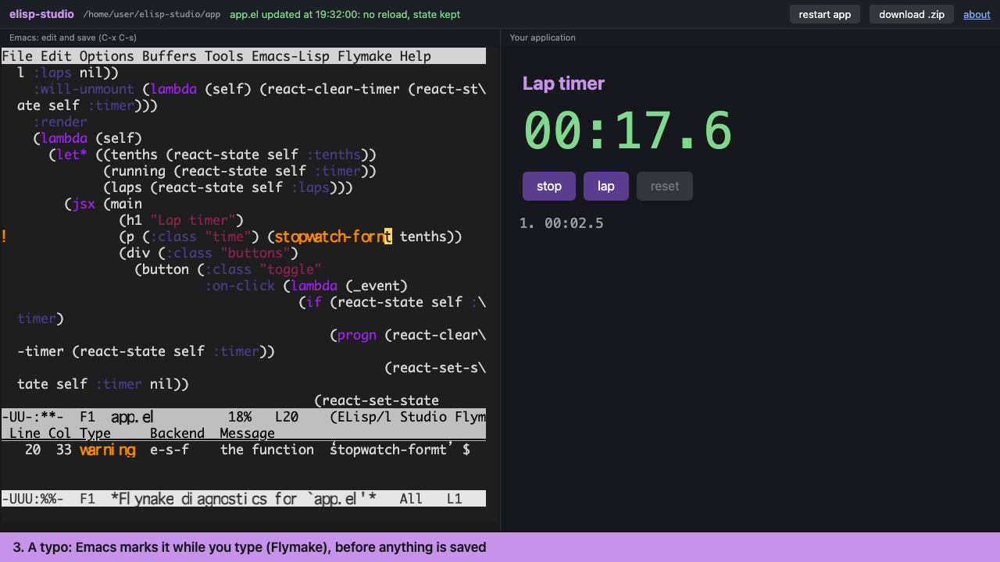
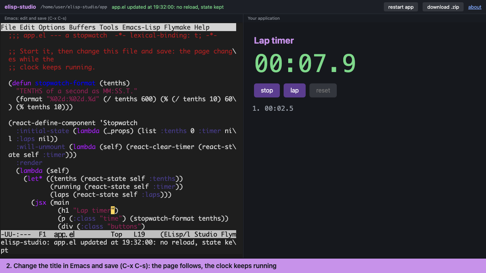

# elisp-studio

Emacs Lisp の Web アプリケーションをブラウザの中で書き、リロードなしで変わるのを見ながら作る環境です。

公開ページ: <https://modeverv.github.io/elisp-studio/> （デスクトップの Chrome 用です。初回は Emacs 本体を約150MBダウンロードし、以後はブラウザが保持します）

[English](README.md)


*Emacs Lisp で書いたストップウォッチを、動かしたまま編集しています。Emacs でタイトルを書き換えて保存し、打ち間違いには入力した時点で Flymake が印を付け、スタイルシートの色を変えています。右の時計は一度も止まりません。（`tools/record-demo.mjs` で録画したものです。同じプロジェクトは [`?example=stopwatch`](https://modeverv.github.io/elisp-studio/?example=stopwatch) で試せます）*

```text
┌──────────────────────────────┬──────────────────────────────┐
│ GNU Emacs                    │ あなたのアプリケーション        │
│ app.el を編集                 │ Emacs Lisp が描画             │
│                              │                              │
│ 書き換えて C-x C-s            │ すぐに変わる                   │
│                              │ リロードなし、state はそのまま   │
└──────────────────────────────┴──────────────────────────────┘
```

左右のどちらも Emacs です。左は本物の GNU Emacs 30.2 で、WebAssembly としてページの中で動き（[wasmacs](https://github.com/modeverv/wasmacs)）、自分のファイルシステムを持っています。右がアプリケーションで、2つ目の Emacs がプロジェクトの Emacs Lisp を [elisp-react](https://github.com/modeverv/elisp-react) で評価してページを描画します。インストールもビルドも要りません。

## 試し方

1. ページを開きます。Emacs が `app.el` を開いた状態で起動し、隣にアプリケーションが表示されます。
2. カウンターを何回かクリックします。
3. Emacs で `app.el` の文字列（たとえば `"Count: %d"`）を書き換え、`C-x C-s` で保存します。
4. アプリケーションの表示が新しい文字列に変わります。カウンターの数はそのままです。

プロジェクトは Emacs のファイルシステムの `/home/user/elisp-studio/app` にあります。ブラウザが保持するので、次に開いたときも残っています。新しいプロジェクトは `template/` から作られます。アドレスに `?example=stopwatch`、`?example=sqlite`、`?example=upload` のいずれかを付けると、`examples/` の該当するディレクトリから作られます。すでにあるプロジェクトが置き換えられることはありません（最初からやり直すには、Emacs の中でこのディレクトリを削除します）。これは wasmacs のページが使っているのと同じ `/home/user` なので、wasmacs を直接開いたときにもプロジェクトが見えます。ファイルは次のとおりです。

```text
index.html   ページ。<div id="app">、スタイルシート、<script type="text/emacs-lisp" src="app.el">
app.el       プログラム（elisp-react を使用）
style.css    スタイルシート
server.el    サーバー側（任意）。ページから /api/... へのリクエストに答える
```

`server.el` がなければ、プロジェクトはどこに置いても単独で動く静的サイトです。

ファイルを保存したときの動作:

| ファイル | 動作 |
|---|---|
| `index.html` が読み込んでいる `.el` | 動いているアプリケーションの中でコンパイルして評価します。定義し直されたコンポーネントは、今の state のまま再描画されます。 |
| `index.html` がリンクしているスタイルシート | その場で差し替えます。 |
| `index.html` | アプリケーションを起動し直します（state は初期化されます）。 |
| `server.el` | 動いているサーバーの中で評価します。サーバーのデータは保たれます。 |

Emacs でプロジェクトのファイルを開いているときに使えるキー:

| キー | |
|---|---|
| `C-x C-s` | 保存。上の表のとおりアプリケーションに反映されます。 |
| `C-M-x` | カーソル位置の定義を、保存せずに動いているアプリケーション（またはサーバー）へ送ります。 |
| `C-c C-p` | 公開。git でプロジェクトをコミットして push します（後述）。 |
| `C-M-i`、`M-.`、`C-h f` | 関数名の補完、定義へのジャンプ、説明の表示。Emacs 自身の関数、elisp-react の関数に加えて、プロジェクトで定義した関数も、定義しているファイルを保存すれば対象になります。入力中は ElDoc が引数を表示します。 |
| `M-g n`、`M-g p` | コンパイラが指摘した次／前の場所へ移動します。 |



入力中は、バイトコンパイラが指摘するはずの箇所に Flymake が印を付けます。編集中の Emacs が、変更のたびに少し間をおいてバッファの内容をコンパイルします。保存も実行もしません。保存したファイルについてアプリケーション側の Emacs が言ったことも戻ってきます。エコーエリアに1行、コンパイラの警告とエラーが `*elisp-studio*` バッファに表示されます（compilation バッファなので `RET` でその場所へ飛べます）。



間違えてもアプリケーションは落ちません。新しいコードが読み込めなければ、エラーをアプリケーションの下に表示し、古いコードのまま動き続けます。無限ループを書いた場合はアプリケーションが止まりますが、止まるのはアプリケーションだけです。次に保存したときに studio が新しいアプリケーションを起動し、Emacs はそのまま編集を続けられます。「restart app」ボタンは、ファイルからアプリケーションを起動し直します。

## サーバー側

`server.el` があるプロジェクトにはサーバーがあります。このファイルは関数を1つ定義します。

```elisp
(defun app-server-handle (method path body)
  (pcase (list method path)
    ('("GET" "/api/messages") (app-server-read "messages" '("Hello")))
    ...))
```

関数は Lisp のデータを返します。ページはそれを印字された形で受け取り、読み戻します。関数がエラーを起こすと、そのエラーがレスポンスになります。3つの引数のほかに、次のものが使えます。

- `(app-server-parameter "name")`：リクエストの `?name=...` の値。
- `(app-server-header "name")`、`(app-server-cookie "name")`：リクエストに付いてきたヘッダーと Cookie。
- `(app-server-set-header "Name" "value")`、`(app-server-set-cookie "name" "value" :max-age 3600)`、`(app-server-delete-cookie "name")`：応答に付けるもの。Cookie は、指定しないかぎり、ページのスクリプトからは見えず、`SameSite=Lax` で、閲覧者が HTTPS で来た場合は `Secure` になります。
- `(app-server-refuse "Sign in first" 401)`：そのメッセージとステータスで断ります。
- `(app-server-token)`：推測できないランダムな名前。セッションに使います。

ログインは、これらの組み合わせです。

```elisp
('("POST" "/api/login")
 (let ((session (app-server-token)))
   (sqlite-execute (app-server-database) "INSERT INTO sessions (name, visitor) VALUES (?, ?)"
                   (list session (app-check-password body)))
   (app-server-set-cookie "session" session :max-age (* 30 24 3600))
   t))
```

サーバーがデータを保持する方法は2つあります。

- `app-server-read` と `app-server-write`：Lisp の値をファイルに保存します。
- `(app-server-database)`：SQLite のデータベースです。Emacs 自身の `sqlite-execute` と `sqlite-select` で使います。ドライバも別のプログラムも要りません。SQLite は Emacs の一部です。

```elisp
(let ((db (app-server-database)))
  (sqlite-execute db "CREATE TABLE IF NOT EXISTS books (id INTEGER PRIMARY KEY, title TEXT NOT NULL)")
  (sqlite-execute db "INSERT INTO books (title) VALUES (?)" (list title))     ; SQL の文字列ではなくパラメータとして渡す
  (sqlite-select db "SELECT id, title FROM books WHERE title LIKE ?" (list (concat "%" search "%"))))
```

[`examples/sqlite`](examples/sqlite) は、この方法でデータを持つ読書リストです（[試す](https://modeverv.github.io/elisp-studio/?example=sqlite)）。studio の中では、データベースはサーバー役の Emacs のメモリ上のファイルで、studio がブラウザ（IndexedDB）に保存して次回に引き継ぎます。ネイティブの Emacs で動かすと `.data/app.db` というファイルになり、`sqlite3` コマンドでも開けます。

SQLite の同梱について：SQLite は[パブリックドメイン](https://www.sqlite.org/copyright.html)なので、配布に条件はありません。ブラウザで動く Emacs には、wasmacs がリンクしています（wasmacs の README の「同梱ソフトウェアとライセンス」を参照）。ネイティブの Emacs は、SQLite つきでビルドされていれば使えます。通常のパッケージはそうなっています（`(sqlite-available-p)` で確認できます）。このリポジトリにも、ダウンロードしたプロジェクトにも、SQLite 自体は含まれません。

studio の中では、サーバーはブラウザのタブの中の3つ目の Emacs です。アプリケーションから `/api/...` へのリクエストはタブの外に出ず、studio がその Emacs に渡します。`server.el` を保存すると、動いているサーバーが変わります。

同じプロジェクトを、ネイティブの Emacs を Web サーバーにして本番として動かせます。そのためのスクリプトは、ダウンロード（次の節）に入っています。

```sh
./run.sh            # http://127.0.0.1:8018/ を開く
```

プロジェクトのファイルを配信し、`/api/...` には同じ `server.el` で答えます。サーバーが保持するデータはプロジェクトの `.data/` に置かれます。ページの Emacs Lisp は、これまでどおり閲覧者のブラウザの中で動きます。

### あとで応答する

何かを待つ必要があるハンドラが、他のリクエストまで待たせる必要はありません。ハンドラは `app-server-defer` を返します。リクエストは開いたままになり、サーバーは他のリクエストの処理に進み、`respond` が呼ばれた時点で応答が送られます。

```elisp
('("GET" "/api/rates")
 (app-server-defer
  (lambda (respond fail)
    (app-server-fetch "https://example.com/rates.json"
                      :then (lambda (response)
                              (if (plist-get response :ok)
                                  (funcall respond (plist-get response :text))
                                (funcall fail "The rates are not available")))))))
```

待てるものは3つあり、どれもサーバーを止めません。

- `(app-server-fetch URL :method :headers :body :then :catch)`：他のサーバーへの HTTP リクエスト。
- `(app-server-after 秒数 関数)`：一定の時間。
- `(app-server-run '("program" "argument") :input 文字列 :then 関数)`：プログラム。たとえば、長い計算を任せる2つ目の Emacs です。関数は `(:status 0 :output "...")` を受け取ります。コマンドはシェルを通りません。

`(funcall fail メッセージ [ステータス])` はリクエストを断ります。あとで動く関数の中のエラーも同じ扱いになり、`app-server-deferred-timeout`（30秒）以内に応答されなかったリクエストには 504 が返ります。同じ `server.el` がスタジオの中でも動きます。そこでは、サーバーの Emacs の代わりにページが時間を計り、リクエストを送ります（したがって、他のサイトへのリクエストにはブラウザの制限がかかります）。プログラムを実行できるのは、ネイティブの Emacs だけです。

計算は「待ち」ではありません。実行中の Emacs Lisp と SQLite は、これまでどおり1つのスレッドを占有します。そのための手段が `app-server-run` です。

### 閲覧者からのファイル

リクエストの本文はハンドラが受け取るテキストで、上限は 1 MB です。ファイルは別扱いです。サーバーは、届いた分から順にディスクへ書き込み、ハンドラにはその名前を渡します。大きさに上限はありません。どのリクエストがファイルを運ぶのかは `server.el` が決めます。判断の材料はヘッダーだけで、ファイルを1バイトも受け取る前に決まります。

```elisp
(defun app-server-upload-p (method path size)
  (and (equal path "/api/photos")
       (app-visitor)                                   ; ログイン済みか（違えば 401 で断る）
       (or (< size (* 200 1024 1024)) (app-server-refuse "Too large" 413))))

('("POST" "/api/photos")
 (let ((name (concat (app-server-token 8) ".jpg")))
   (app-server-keep-upload name)                       ; これで (app-server-file name) になる
   name))
('("GET" "/api/photo")
 (app-server-send-file (app-server-file (app-server-parameter "name")) :type "image/jpeg"))
```

`(app-server-upload)` は `(:file FILE :size BYTES :type STRING)` を返します。FILE は一時ファイルで、ハンドラが保存しなければ、応答とともに消えます。`(app-server-file NAME)` は、アプリケーションが保存しているファイル（`.data/files/`）のうちの1つです。NAME でそれ以外の場所を指すことはできません。`(app-server-files)` はその一覧を返し、`(app-server-send-file FILE :type :name)` はファイルを少しずつ読みながら応答として送ります。

ページは、フォームではなく、ファイルそのものを本文として送ります。elisp-react では `react-fetch` のオプション1つです。ファイルは Lisp を通らず、ファイル入力からサーバーへ直接送られます。

```elisp
(input (:type "file" :ref "file"
        :on-change (lambda (event) (react-set-state self :chosen (aref (plist-get event :files) 0)))))
...
(react-fetch "/api/photos" :method "POST" :file (react-ref self "file") :then ...)
```

[`examples/upload`](examples/upload) は、これで作ったファイル置き場です（[試す](https://modeverv.github.io/elisp-studio/?example=upload)）。計測では、300 MB が 1.2 秒で届き（毎秒 240 MB）、その間のサーバーのメモリ増加は 30 MB でした。同じファイルは 0.8 秒で戻り、チェックサムも一致しました。その間も、2人が低速でダウンロードしている間も、他のリクエストへの応答速度は変わりませんでした。studio のタブの中では、ファイルは base64 で運ばれてメモリに置かれます。上限は 32 MB で、アップロードを試すには十分です。

### パスワード

パスワードそのものは保存しません。保存するのは、計算に時間のかかるハッシュです。データベースが盗まれても、毎秒10億回の速さでパスワードを探されないようにするためです。`app-server.el` には、HMAC-SHA-256 による PBKDF2（60万回。OWASP がこの方式に示している回数）が入っています。Emacs 自身の `secure-hash` で書かれており、RFC 7914 のテストベクトルで確認しています。「時間がかかる」とは、1コアを2秒使うという意味です。そのため計算は2つ目の Emacs に任せ、サーバーは他のリクエストに応答し続けます。

```elisp
('("POST" "/api/login")
 (let* ((sent (car (read-from-string body))) (name (car sent)) (password (cadr sent)))
   (app-server-defer
    (lambda (respond fail)
      (app-server-password-check-later
       password (app-stored-hash name)
       (lambda (right)
         (if (not right)
             (funcall fail "Wrong name or password" 401)
           (app-server-set-cookie "session" (app-new-session name))
           (funcall respond t))))))))
```

`(app-server-password-hash-later PASSWORD FUNCTION)` は、保存するハッシュ（`"pbkdf2-sha256$600000$SALT$HASH"`）を作ります。どちらも、スクリプト用に `-later` なしの版があります。

より強い方式を使っていない理由：探した範囲では、Emacs Lisp で書かれた bcrypt、scrypt、Argon2 は見つかりませんでした。見つかったのは、[kaesar-pbkdf2.el](https://github.com/mhayashi1120/Emacs-kaesar)（Lisp で書かれた PBKDF2、GPL）、[pg-el](https://github.com/emarsden/pg-el) の中の PBKDF2（GnuTLS 経由、PostgreSQL の SCRAM 認証用）、そしてモジュールとしてコンパイルが必要な libsodium のバインディング2つ（`crypto_box` だけを公開している [sodium.el](https://github.com/dakra/sodium.el) と、Rust で書かれた [esodium](https://codeberg.org/coopi/emacs-esodium)）です。PBKDF2 は `secure-hash` の上に30行で書け、ネイティブの Emacs でもブラウザの Emacs でも、何もインストールせずに動きます。上記の回数であれば認められている選択肢ですが、GPU による攻撃への強さでは Argon2 が上です。数文字のパスワードは、どの方式でも弱いままです。

### 公開する

サーバーは 127.0.0.1 で待ち受け、暗号化しない HTTP を話します。アプリケーションをインターネットに出すときは、同じマシンでリバースプロキシを手前に置きます。HTTPS、HTTP/2、圧縮は Caddy か nginx が担当し、残りを Emacs が担当します。サーバーには、公開されるアドレスを伝えます。

```sh
PUBLIC_ORIGIN=https://example.com ./run.sh
```

ダウンロードした ZIP の `server/deploy/` に設定が入っています。`Caddyfile`（4行）、`nginx.conf`、そして `run.sh` を動かし続ける systemd のユニットです。この構成のためにサーバーが行うことは次のとおりです。

| | |
|---|---|
| 公開オリジン | 他のサイトのページからの `/api/` へのリクエストは断ります。どのページが自分のアプリケーションのものかを `PUBLIC_ORIGIN` で伝えます。 |
| 閲覧者が誰か | `(app-server-header "x-forwarded-for")` と `"x-forwarded-proto"` はプロキシからの情報です。サーバーに届くのはこのマシンからの接続だけなので、信用できます。同梱の設定はどちらも、閲覧者が自分で付けたこれらのヘッダーを上書きします。 |
| Cookie とログイン | 上記のとおりです。オリジンの確認と `SameSite=Lax` により、他のサイトからのリクエストでは使えません。 |
| 接続の維持 | プロキシからの接続は、リクエストの間も開いたままです。先に送られたリクエストには、順番に応答します。 |
| 上限 | 本文は 1 MB まで（`serve-project-max-body`）、ヘッダーは 16 KB まで。長さの指定がない本文は断ります（nginx と Caddy は長さを付けて転送します）。 |
| 遅い、または黙っている接続 | 途中まで送られたリクエストは20秒、何も送らない接続は180秒で切ります（プロキシが接続を保つ時間より長くしてあります）。 |
| ファイル | `ETag` を付けて送り、変わっていないファイルには `304` で応答します。`server.el`、`server/`、`.data/`、隠しファイル、およびシンボリックリンクでプロジェクトの外に出るものは送りません。 |
| ログ | 標準エラー出力に、リクエストごとに1行（メソッド、パス、ステータス、ミリ秒）。 |
| 複数のコア | `WORKERS=4 ./run.sh` で、4つの Emacs プロセスが4つのポートで起動し、プロキシがリクエストを振り分けます（方法は同梱の設定に書いてあります）。プロセスは `.data/` を共有します。SQLite は先行書き込みログ（WAL）に切り替わり、使用中のデータベースを待ちます。`app-server-write` はファイルを一度に置き換えます。ハンドラが Lisp の変数に持たせたものは、1つのワーカーしか知りません。セッションはデータベースに置いてください。ワーカーが1つ終了すると、スクリプトが全ワーカーを終了させ、systemd がまとめて起動し直します。 |
| アップロード | Caddy は、どの大きさの本文も届いた分から転送します。nginx では、同梱ファイルの `client_max_body_size` が上限です。 |

同梱の設定を使い、Caddy 2.11（HTTPS、HTTP/2）と nginx 1.30 を手前に置いて確認しました。ページ、ログイン、あとからの応答、圧縮、`304` がすべて通ります。300 MB のファイルは、どちらを経由しても、送って取り戻した内容が一致しました（送り先は4つのワーカーで、送ったあとは全ワーカーからそのファイルが見えます）。Caddy 経由の2万リクエストの負荷（毎秒2万2千件）で失敗はありませんでした。6分間の混合負荷（250万リクエスト、うち SQLite への挿入が37万件）はエラーなしで終わりました。2回目の計測では、ガベージコレクション後に生きている Lisp オブジェクトの数が、どの種類の負荷のあとも開始時と同じでした（Lisp 側のリークはありません）。プロセスのメモリは 59 MB から 105 MB まで増え、そこで止まりました。確認したのは15分間であり、数週間ではありません。systemd のユニットは実行していません。

ないもの：ストリーミング応答と WebSocket、フォームによるアップロード（`multipart/form-data`。ページはファイルそのものを送ります）、ファイルの一部分だけの送信（動画の途中からの再生はできません）。このサーバーを本気で攻撃した人はまだいません。プロキシの後ろに置く数百行の Emacs Lisp であり、身内向けのアプリケーションのためのものです。

### このサーバーの速さ

1つの Emacs、1つのスレッドで、Node.js と同じ動き方をします。接続は OS の中で待ち、Emacs はリクエストを1つ受け取り、ハンドラを最後まで実行し、応答して、次を受け取ります。`server.el` とサーバー自身は、起動時にバイトコンパイルされます。Apple M4 Max、Emacs 31.1 で、ApacheBench を使って同時10接続で計測した結果です（`ab -n 10000 -c 10`。`-k` を付けると、プロキシと同じように接続を維持します）。

| リクエスト | 毎回新しい接続 | 接続を維持 |
|---|---|---|
| 小さな plist を返すだけのハンドラ | 19,700 | 28,000 |
| 本文を読んでそのまま返す POST | 21,200 | 27,300 |
| `(fib 20)` を計算するハンドラ（関数呼び出し2万2千回） | 2,720 | 2,790 |
| `app-server-read`（ファイルの読み込み） | 19,800 | 23,100 |
| SQLite の `SELECT` | 20,500 | 21,900 |
| SQLite の `INSERT`（ディスクへの書き込み） | 2,810 | 2,180 |
| 静的ファイル | 9,100 | 10,500 |
| ブラウザが持っている静的ファイル（`304`） | | 16,200 |

Caddy の後ろに複数のワーカーを置いた場合（`ab -k -c 40`）、計算をするハンドラは、ワーカー1つで毎秒2,630件、2つで5,320件、4つで10,500件と、コアの数だけ速くなります。SQLite の `SELECT` は17,000件から34,900件になります。4つのワーカーから同時に行った挿入は、すべて書き込まれました（15,000件中15,000件、毎秒約1万件）。

比較のために、同じマシンの Node.js 26 では、小さな応答が毎秒21,200件（接続を維持すると66,800件）、`fib(20)` が11,000件でした。Emacs は、同時1接続では毎秒7,300件、同時100接続では毎秒20,400件です。同じ瞬間に百を大きく超える接続が届くと、OS がサーバーのために保持する待ち行列を超えます。手前にプロキシがあれば、その心配はありません。

時間のかかるハンドラは、あとで応答しないかぎり、後ろに並んでいる全員を待たせます。シングルスレッドのイベントループに共通の性質です。他の何かに 100 ms かかるハンドラを、同じ方法で計測しました。

| ハンドラ | 同時10接続 | 50 | 100 |
|---|---|---|---|
| プログラムを実行して終了を待つ（`call-process`） | 毎秒9件 | 9件（半数が3秒以上待つ） | |
| `app-server-run` で実行し、あとで応答する | 86 | 426 | 840 |
| Emacs の中で待つ（`sleep-for`） | 89 | | 97% を断る（503） |
| `app-server-after` で、あとで応答する | 90 | | 869 |
| 他のサーバーに問い合わせて待つ（`url-retrieve-synchronously`） | 81 | | 98% を断る（503） |
| `app-server-fetch` で、あとで応答する | 91 | | 904 |

あとで応答する場合の件数は、単純に「接続数 ÷ 0.1 秒」です。誰も、誰かを待っていません。次の表は、50 接続がプログラムを要求し続けている間に、最初の表の「plist を返すだけのハンドラ」がどうなるかです。

| その間 | plist を返すだけのハンドラ | 最も遅いリクエスト |
|---|---|---|
| プログラムの終了を待つ | 毎秒184件 | 5.4 秒 |
| `app-server-run` でプログラムを実行する | 毎秒9,400件 | 6 ms |

あとで応答すること自体のコストは、ほぼありません。`app-server-defer` を返してすぐに応答するハンドラは毎秒19,700件です。Emacs の中での待ちには注意が必要です。`sleep-for` と `url-retrieve-synchronously` は、待っている間に次のリクエストを受け付け、そのリクエストは待っているハンドラの「内側」で実行されます。10件なら問題ありませんが、100件ではスタックを使い切ってサーバーが終了していました。現在は、32件を超えるとリクエストを 503 で断ります。

## プロジェクトを外に出す

- ヘッダーの **download .zip**：プロジェクトを1つのアーカイブにします。bash と GNU Emacs（29以降）があれば、それだけで動きます。

  ```text
  index.html, app.el, style.css, server.el    プロジェクト
  run.sh              ./run.sh [PORT]。Emacs がこのディレクトリの Web サーバーになる
  fetch-emacs.sh      任意。ブラウザ用の Emacs を vendor/ にダウンロードする（約160MB、curl が必要）
  server/             run.sh が Emacs に読み込ませるもの（HTTP サーバーと app-server.el）
  README.txt
  ```

  `./run.sh` を実行すると、Emacs がページを配信し、ページからのリクエストに答えます。ブラウザの中でページの `app.el` を動かす Emacs は、通常はページが wasmacs のサイトからダウンロードします。`./fetch-emacs.sh` を実行したあとは、同じ Emacs が `vendor/` から配信するようになり、インターネットは不要になります。
- Emacs の **`C-c C-p`**（`M-x elisp-studio-publish`）：Emacs の中で動く git で `git add`、`git commit` を行い、`origin` というリモートがあれば `git push` します。GitHub へ HTTPS で push するには、[wasmacs の companion 拡張](https://github.com/modeverv/wasmacs#network-access)と、リモートの認証情報が必要です（最初に1回、`M-x shell` で `cd ~/elisp-studio/app`、`git remote add origin https://github.com/YOU/REPOSITORY.git`）。`server.el` のないプロジェクトを GitHub Pages を有効にしたリポジトリに push すれば、そのまま Web に公開されます。

## 言語サーバー（LSP）は？

Emacs の LSP クライアントである Eglot は、この Emacs に入っていて読み込めます。足りないのは相手になる言語サーバーです。wasmacs の process service 向けにビルドされたプログラムである必要があり、今はありません。Emacs Lisp については言語サーバーは不要です。補完、説明、定義へのジャンプは Emacs 自身の機能で、診断は Emacs のバイトコンパイラから得ています。

## 仕組み

```text
studio のページ (js/studio.js)
  ├─ iframe: wasmacs（エディタ）             ../wasmacs/app/xterm-atomics-pdump.html?embed=1
  │     Emacs がファイルを保存 -> ページが /home/user の tar イメージを受け取る (postMessage)
  ├─ iframe: アプリケーション                 プロジェクトの index.html を srcdoc として表示
  │     elisp-react の土台と wasmacs の評価サービス（2つ目の Emacs）
  │     変更された .el -> app.load(name, text) -> 定義し直されたコンポーネントが再描画される
  └─ worker: サーバー                        評価サービスをもう1つ（3つ目の Emacs）。server.el を実行
        アプリケーションの fetch("/api/...") -> app-server-respond -> レスポンス
```

studio は、単独でも存在する2つのものをつなぐ配線にすぎません。エディタはファイルが変わるたびに中身を報告し、studio はそれをアプリケーションが持っているものと比べて、差分を渡します。詳しくは [doc/design.md](doc/design.md) を参照してください。

## 開発

studio は、同じオリジンに2つの兄弟サイトを必要とします。このリポジトリの隣に checkout（ビルド済みの `../wasmacs` と `../elisp-react`）がある状態で実行します。

```sh
npm run serve            # http://127.0.0.1:5190/elisp-studio/
npm run test:unit        # tar、zip、ネイティブの Emacs で配信したプロジェクト
npm run test:e2e         # headless Chrome で studio を操作
npm run test:e2e:plain   # 同じテストを、GitHub Pages と同じく分離ヘッダーなしで実行
npm run test:e2e:sqlite  # SQLite のサンプル。studio の中で動かし、ダウンロードして単独でも動かす
npm run test:e2e:upload  # アップロードのサンプルを studio の中で動かす
node tools/record-demo.mjs   # この README の画像を録画し直す（ffmpeg が必要）
```

## 制限

- デスクトップの Chrome が対象です。タブの中で Emacs が2つ動くので、メモリを数百MB使います。
- プロジェクトは1つです。
- ホットリロードのあと、既存のコンポーネントの `:initial-state` と `:did-mount` は実行し直されません。最初からやり直すには「restart app」を使います。
- アプリケーションの実行中に起きたエラーには、場所の情報がありません。
- 編集中の Emacs は、バッファを検査するときにプロジェクトのマクロを展開します。無限ループするマクロを書くと、エディタが固まります。
- GitHub への push は、Emacs 自身のファイルシステム内のリポジトリに対してだけテストしています。companion 拡張を通る経路は wasmacs のもので、そちらでテストされています。
- タブの中のサーバーは、データのディレクトリをメモリ上に持ちます。studio は、内容を変えたリクエストのあとでそれを IndexedDB にコピーします。小さなデータベースなら問題ありませんが、大きなものには向きません。
- `run.sh` は 127.0.0.1 でだけ待ち受けます。公開する場合や、複数のコアを使う場合は、手前にリバースプロキシが必要です（あるものとないものは、上の「公開する」にあります）。
- studio のタブの中では、`app-server-token` が使えるのは Emacs の `random` だけで、パスワードのハッシュは60万回ではなく1万回、アップロードできるファイルは 32 MB までです。Cookie は、studio を再読み込みするまで保持されます。タブはアプリケーションを書く場所であり、他の人に向けて動かす場所ではありません。
