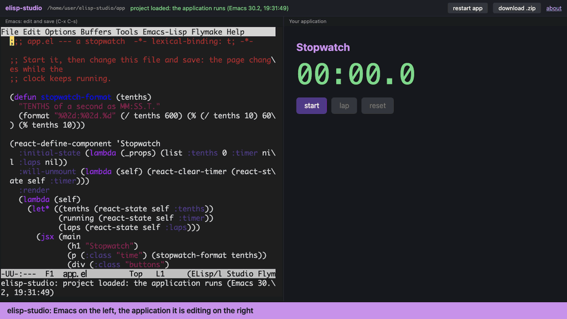
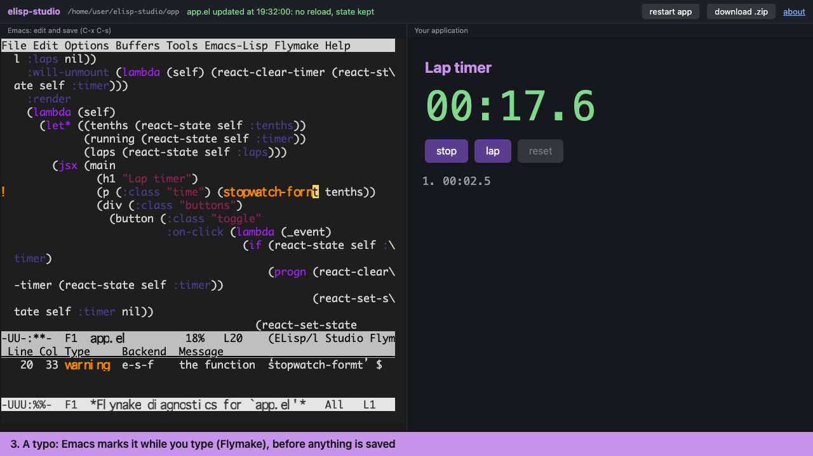
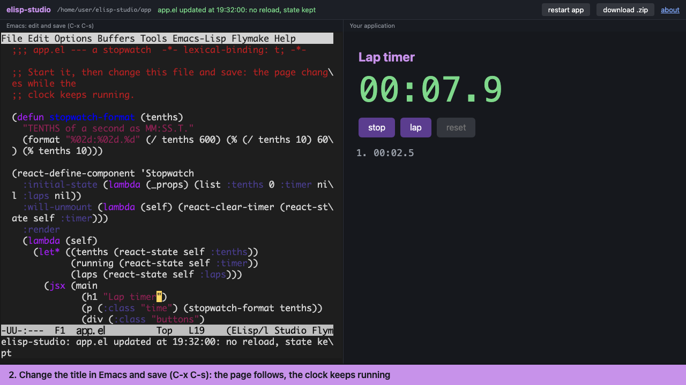

# elisp-studio

Write a web application in Emacs Lisp, in the browser, and watch it change without a reload.

Live: <https://modeverv.github.io/elisp-studio/> (Chrome on a desktop; the first visit downloads the editor's Emacs, about 150 MB, which the browser then keeps. An application made here is another matter: its visitors download about 5 MB).

[日本語](README.ja.md)



*A stopwatch written in Emacs Lisp, edited while it runs. The title is changed in Emacs and saved; a typo is marked by Flymake as it is typed; the stylesheet's colour is changed. The clock on the right never stops. (Recorded by `tools/record-demo.mjs`; try the same project at [`?example=stopwatch`](https://modeverv.github.io/elisp-studio/?example=stopwatch).)*

```text
┌──────────────────────────────┬──────────────────────────────┐
│ GNU Emacs                    │ your application             │
│ editing app.el               │ drawn by Emacs Lisp          │
│                              │                              │
│ change it, C-x C-s           │ changes at once:             │
│                              │ no reload, state kept        │
└──────────────────────────────┴──────────────────────────────┘
```

Both halves are Emacs. On the left is the real GNU Emacs 30.2, running in the page as WebAssembly ([wasmacs](https://github.com/modeverv/wasmacs)), with its own filesystem. On the right is the application: a second Emacs evaluates the project's Emacs Lisp with [elisp-react](https://github.com/modeverv/elisp-react) and draws the page. Nothing is installed and nothing is built.

## Try it

1. Open the page. Emacs starts with `app.el`; the application appears next to it.
2. Click the counter a few times.
3. In Emacs, change a text in `app.el`, for example `"Count: %d"`, and save with `C-x C-s`.
4. The application shows the new text, and the counter still has its count.

The project is `/home/user/elisp-studio/app` in Emacs's filesystem, which the browser keeps: it is still there at the next visit. A new project starts from `template/`, or, with `?example=stopwatch`, `?example=sqlite` or `?example=upload` in the address, from that directory of `examples/`; a project that exists is never replaced (remove the directory in Emacs to start over). It is the same `/home/user` that the wasmacs page itself uses, so the project is also there when you open wasmacs directly. Its files:

```text
index.html   the page: a <div id="app">, the stylesheet, <script type="text/emacs-lisp" src="app.el">
app.el       the program, with elisp-react
style.css    the stylesheet
server.el    the server side (optional): answers the page's requests to /api/...
```

Without `server.el` the project is a static web site that works on its own, anywhere.

What happens when a file is saved:

| File | Effect |
|---|---|
| a `.el` file that `index.html` loads | Compiled and evaluated in the running application. Components that are defined again render with the state they have. |
| a stylesheet that `index.html` links | Swapped in place. |
| `index.html` | The application starts again (its state is reset). |
| `server.el` | Evaluated in the running server, which keeps its data. |

In Emacs, in a file of the project:

| Key | |
|---|---|
| `C-x C-s` | Save: the change reaches the application as described above. |
| `C-M-x` | Send the definition at point to the running application (or server) without saving. |
| `C-c C-p` | Publish: commit the project with git and push it (see below). |
| `C-M-i`, `M-.`, `C-h f` | Complete, find and describe functions: Emacs's, those of elisp-react, and the project's own once the file that defines them is saved. ElDoc shows arguments while you type. |
| `M-g n`, `M-g p` | Go to the next or previous place the compiler complained about. |



While you type, Flymake marks what the byte compiler would complain about: the editing Emacs compiles the buffer's text a moment after each change, without saving or running it. What the application's Emacs says about a saved file comes back too: one line in the echo area, and the compiler's warnings and errors in the buffer `*elisp-studio*` (a compilation buffer: `RET` jumps to the place).



A mistake does not take the application down: if the new code does not load, the error is shown under the application and the old code keeps running. An endless loop does take it down, and only it: the studio starts a new application at the next save, and Emacs keeps editing. The "restart app" button starts the application again from the files.

The application has an address even though the preview is a frame without one: elisp-react keeps it in memory there (`react-location`, `react-navigate`), and the bar above the application shows it. Hash links in the application stay in the preview; type an address and press Enter to go there, or use ← and → for Back and Forward.

The project's other files reach the application too. `react-fetch` of a relative URL (`"data.json"`) gets the project's file, in both studios. On your own machine the server also serves the directory at `/__project/files/` and the preview's relative URLs resolve there, so `` and fonts work; not served are hidden files, `server*`, `*.sh` and `.data/`. In the studio in the page, files that are not text (images) are kept as bytes, but only `react-fetch` reaches them: an `` needs a `data:` URL there.

## A server side

A project with a `server.el` has a server. The file defines one function:

```elisp
(defun app-server-handle (method path body)
  (pcase (list method path)
    ('("GET" "/api/messages") (app-server-read "messages" '("Hello")))
    ...))
```

It returns Lisp data, which the page gets printed and reads back; an error it signals is the response. Around the three arguments:

- `(app-server-data body)`: the body as Lisp data. Use this and not `read`: Emacs's reader keeps every new name it meets as a symbol for good, so a visitor could fill the server's memory with names. `app-server-data` lets through strings, numbers, lists, vectors and the symbols this Emacs already knows, and nothing a visitor sends is ever evaluated.
- `(app-server-parameter "name")`: the value of `?name=...` in the request.
- `(app-server-header "name")`, `(app-server-cookie "name")`: what came with the request.
- `(app-server-set-header "Name" "value")`, `(app-server-set-cookie "name" "value" :max-age 3600)`, `(app-server-delete-cookie "name")`: what goes with the answer. A cookie is hidden from the page's scripts, `SameSite=Lax`, and `Secure` when the visitor came over HTTPS, unless told otherwise.
- `(app-server-refuse "Sign in first" 401)`: answer with that message and status.
- `(app-server-token)`: a random name nobody can guess, for a session.

Signing in is made of these; the section "Signing in" below has it whole.

The server can keep data in two ways:

- `app-server-read` and `app-server-write`: Lisp values in files.
- `(app-server-database)`: an SQLite database, used with Emacs's own `sqlite-execute` and `sqlite-select`. No driver and no other program is involved: SQLite is part of Emacs.

```elisp
(let ((db (app-server-database)))
  (sqlite-execute db "CREATE TABLE IF NOT EXISTS books (id INTEGER PRIMARY KEY, title TEXT NOT NULL)")
  (sqlite-execute db "INSERT INTO books (title) VALUES (?)" (list title))     ; a parameter, not SQL text
  (sqlite-select db "SELECT id, title FROM books WHERE title LIKE ?" (list (concat "%" search "%"))))
```

[`examples/sqlite`](examples/sqlite) is a reading list kept that way ([try it](https://modeverv.github.io/elisp-studio/?example=sqlite)). In the studio the database is a file in the memory of the server's Emacs, which the studio keeps in the browser (IndexedDB) between visits; under a native Emacs it is the file `.data/app.db`, which the `sqlite3` command line tool can open too.

About bundling SQLite: it is in the [public domain](https://www.sqlite.org/copyright.html), so there are no conditions on shipping it. The Emacs that runs in the browser has it linked in by wasmacs (see "Licence" there); a native Emacs has it if it was built with SQLite, which the usual packages are (`(sqlite-available-p)` tells). Nothing of SQLite is in this repository or in a downloaded project.

In the studio the server is a third Emacs in the browser tab. The application's requests to `/api/...` never leave the tab: the studio hands them to that Emacs. Saving `server.el` changes the running server.

The same project runs for real under a native Emacs, which then is the web server. The download (next section) brings the script for it:

```sh
./run.sh            # then open http://127.0.0.1:8018/
```

It serves the project's files and answers `/api/...` with the same `server.el`; what the server keeps goes to `.data/` in the project. The page's Emacs Lisp still runs in the visitor's browser.

### Answering later

A handler that has to wait for something need not make every other request wait with it. It returns `app-server-defer`; the request stays open, the server goes on, and the answer is sent when `respond` is called:

```elisp
('("GET" "/api/rates")
 (app-server-defer
  (lambda (respond fail)
    (app-server-fetch "https://example.com/rates.json"
                      :then (lambda (response)
                              (if (plist-get response :ok)
                                  (funcall respond (plist-get response :text))
                                (funcall fail "The rates are not available")))))))
```

There are three things to wait for, none of which blocks:

- `(app-server-fetch URL :method :headers :body :then :catch)`: an HTTP request to another server.
- `(app-server-after SECONDS FUNCTION)`: a moment.
- `(app-server-run '("program" "argument") :input STRING :then FUNCTION)`: a program, a second Emacs for long computations for instance. The function gets `(:status 0 :output "...")`. No shell reads the command.

`(funcall fail MESSAGE [STATUS])` refuses the request, an error in a function that runs later does the same, and a request that is not answered within `app-server-deferred-timeout` (30 seconds) gets a 504. The same `server.el` works in the studio, where the page keeps the time and makes the requests for the server's Emacs (so the browser's rules for requests to other sites apply there); programs exist only under a native Emacs.

Computing is not waiting: Emacs Lisp that runs, and SQLite, still hold the one thread. That is what `app-server-run` is for.

### Files from visitors

The body of a request is text for the handler, a megabyte at most. A file is something else: the server writes it to disk as it arrives, whatever its size, and the handler gets its name. Which requests bring a file is for `server.el` to say, having seen only the headers, before a byte of it is taken:

```elisp
(defun app-server-upload-p (method path size)
  (and (equal path "/api/photos")
       (app-visitor)                                   ; signed in? (refuses with 401 otherwise)
       (or (< size (* 200 1024 1024)) (app-server-refuse "Too large" 413))))

('("POST" "/api/photos")
 (let ((name (concat (app-server-token 8) ".jpg")))
   (app-server-keep-upload name)                       ; now it is (app-server-file name)
   name))
('("GET" "/api/photo")
 (app-server-send-file (app-server-file (app-server-parameter "name")) :type "image/jpeg"))
```

`(app-server-upload)` is `(:file FILE :size BYTES :type STRING)`, a temporary file that is gone with the answer unless the handler kept it. `(app-server-file NAME)` is a file among those the application keeps (`.data/files/`); NAME cannot point anywhere else. `(app-server-files)` lists them, and `(app-server-send-file FILE :type :name)` answers with one, read and sent piece by piece.

The page sends the file itself as the body, not a form. In elisp-react that is one option of `react-fetch`; the file goes from the file input to the server without passing through Lisp:

```elisp
(input (:type "file" :ref "file"
        :on-change (lambda (event) (react-set-state self :chosen (aref (plist-get event :files) 0)))))
...
(react-fetch "/api/photos" :method "POST" :file (react-ref self "file") :then ...)
```

[`examples/upload`](examples/upload) is a shelf of files made of this ([try it](https://modeverv.github.io/elisp-studio/?example=upload)). Measured: 300 MB arrive in 1.2 seconds (240 MB per second) while the server's memory grows by 30 MB, come back in 0.8 seconds with the same checksum, and other requests are answered at their usual rate meanwhile, also while two visitors download slowly. In the studio's tab a file travels as base64 and is kept in memory: 32 MB at most, enough to try an upload out.

### Signing in

```elisp
('("POST" "/api/login")
 (let* ((sent (app-server-data body)) (name (car sent)) (password (cadr sent))
        (address (app-server-visitor-address)))
   (app-server-attempts-check name address)             ; 429 after five failures in ten minutes
   (app-server-defer
    (lambda (respond fail)
      (app-server-password-check-later
       password (app-stored-hash name)
       (lambda (right)
         (if (not right)
             (progn (app-server-attempts-failed name address)
                    (funcall fail "Wrong name or password" 401))
           (app-server-attempts-clear name)
           (app-server-session-start name)              ; a cookie, for thirty days
           (funcall respond t))))))))
('("GET" "/api/me") (or (app-server-session) (app-server-refuse "Sign in first" 401)))
('("POST" "/api/logout") (app-server-session-end) t)
```

- **Sessions.** `(app-server-session-start VISITOR)` gives the browser a cookie with a random name for the session and keeps a hash of that name with VISITOR (any Lisp data: a name, a number, a plist) and an expiry, so the database holds nothing that would let someone in. `(app-server-session)` is VISITOR on later requests, or nil. `(app-server-session-end)` signs out; `(app-server-session-end-all VISITOR)` signs out everywhere, for when a password was changed. The cookie is `HttpOnly` (neither the page's Lisp nor a script sees it), `SameSite=Lax`, and `Secure` when the proxy says the request came over HTTPS. A session ends thirty days after it began (`app-server-session-days`, or a second argument in days); using it does not extend it.
- **A limit on guesses.** `(app-server-attempts-check NAME ADDRESS ...)` refuses with 429 and `Retry-After` when there were five failures in ten minutes for one of its arguments (`app-server-attempts-max`, `app-server-attempts-seconds`); `-failed` notes a failure, `-clear` forgets them. Counting by account stops guesses at one account from many addresses, counting by address stops one address trying many accounts. `(app-server-visitor-address)` is what the reverse proxy says; without a proxy everyone is this machine and only the account counts.
- **Short passwords** (under `app-server-password-min-length`, 8) are refused when a hash is to be made: no hash makes those hard to guess.
- **Old hashes.** After the rounds were raised or the algorithm changed, `(app-server-password-needs-rehash-p HASH)` says which hashes to make again, at the one moment the password is at hand: right after it checked.
- **Not telling which names exist.** A check for an account that does not exist takes as long as one for an account that does.

Sessions and failures are in an SQLite database of their own, `.data/server.db`: workers share them, and a restart signs nobody out. An Emacs without SQLite keeps them in memory instead: there a restart signs everybody out, and workers do not share them.

An application for people who already have an account somewhere needs none of this. Let the proxy sign them in (Caddy's `forward_auth` or `basic_auth`, oauth2-proxy in front of nginx) and read who it is from the header the proxy sets, `(app-server-header "x-forwarded-user")` or whatever it is called there. The proxy must overwrite that header on every request, or a visitor could set it.

### Tokens (JWT)

A session is the server's note of who signed in. A JWT is the other arrangement: the visitor carries a signed note and the server keeps nothing. This server has sessions, and no functions for JWTs. What can be done about them was tried on 2026-11-15; none of it is shipped or covered by the tests.

| | |
|---|---|
| A token the application signs and checks itself (HS256: HMAC-SHA-256 with a secret) | Possible in `server.el`, in under thirty lines, with what every Emacs has: `secure-hash`, `base64url-encode-string`, `json-serialize`, `json-parse-string`; HMAC is six lines on `secure-hash`. With the same code, a native Emacs 31.1 and the browser's Emacs 30.2 verified a known token and refused a wrong secret, `alg: none` and an expired token. A check takes 0.1 ms uncompiled. |
| Carrying it | The page sends it with `react-fetch`'s `:headers (:authorization "Bearer …")` and `server.el` reads `(app-server-header "authorization")`. Tried from Chrome against a native server; the studio's tab hands the header to `server.el` the same way (the browser test asks for it). |
| A token somebody else signed (RS256, ES256: Google, Microsoft Entra ID, any OpenID Connect provider) | Not possible. It takes a public-key signature check, and Emacs has no function for one. A native server would have to call a program such as `openssl` (not tried); the browser's Emacs has no program to call. Signing in through such a provider is the proxy's job (the paragraph above). |

For the application's own sign-in the session is the better fit. Signing out takes effect at once, on every device if wanted; a signed token stays good until it runs out, unless the server keeps a list of the ones it took back, which is a session again. What a token saves is a store shared by the workers, and they have one. A token earns its place when another program must check who someone is without asking this server; with HS256 that program needs the same secret.

Whoever writes it: accept one algorithm, never the one the token names; check `exp`; compare the two signatures without stopping at the first difference (compare their `secure-hash`es); keep the secret in `.data/`, which is never served, or in the environment, the same for all workers (changing it ends every token). A token does not open the API to pages of other sites: their requests are refused whatever they carry, a CORS preflight included (403).

### Passwords

A password is not kept; a hash that is slow to make is, so that a stolen database cannot be searched for passwords at a billion guesses a second. `server.el` asks for one (`app-server-password-hash-later`) and for a check of one (`app-server-password-check-later`, above), and does not see where the arithmetic is done.

`(app-server-password-hash-later PASSWORD FUNCTION)` makes the hash to store. Who computes it depends on where the server runs:

| Where | Who computes | 600,000 rounds |
|---|---|---|
| a native Emacs with `python3` on the machine | another process: Python's `hashlib`, which is OpenSSL's C | 0.11 s per sign-in |
| a native Emacs without | a second Emacs, running thirty lines of Lisp on `secure-hash` | 2.2 s |
| the studio's browser tab | the page, with the browser's Web Crypto | 0.07 s |

The hash is PBKDF2 with HMAC-SHA-256 and 600,000 rounds (the count OWASP gives for it): the one all three can compute. They give the same bytes, which the tests check against Node.js and the vectors of RFC 7914, so a hash made by one is verified by any other. The server never waits: 32 sign-ins at once leave the other requests at 18,000 per second. As many hashes are computed at the same time as there are cores (`app-server-password-jobs`), the rest wait their turn; on this machine that is 74 sign-ins per second. The server's log says at the start who hashes.

For a hash that costs an attacker memory as well as time, one line in `server.el`:

```elisp
(setq app-server-password-algorithm 'scrypt)       ; N = 2^17, r = 8, p = 1: 128 MB and 0.34 s per sign-in
```

Only `python3` computes scrypt, and only one whose `hashlib` has it (the one macOS ships does not; Homebrew's and Linux distributions' do). Where it is missing, and in the studio's tab, such a request fails with "This server cannot make scrypt hashes" rather than falling back to something weaker. A hash says how it was made (`pbkdf2-sha256$600000$SALT$HASH`, `scrypt$ln=17,r=8,p=1$SALT$HASH`), so changing the setting leaves the hashes that exist valid; both kinds are checked by the same `app-server-password-check-later`.

Why not bcrypt or Argon2: Python's standard library has neither, the browser neither, and a search turned up none written in Emacs Lisp. What there is: [kaesar-pbkdf2.el](https://github.com/mhayashi1120/Emacs-kaesar) (PBKDF2 in Lisp, GPL), a PBKDF2 inside [pg-el](https://github.com/emarsden/pg-el) (through GnuTLS, for PostgreSQL's SCRAM), and two bindings to libsodium that have to be compiled as modules ([sodium.el](https://github.com/dakra/sodium.el), which exposes `crypto_box` only, and [esodium](https://codeberg.org/coopi/emacs-esodium), in Rust). A password of a few characters stays weak under any of them.

### Publishing it

The server listens on 127.0.0.1 and speaks plain HTTP. To put the application on the internet, a reverse proxy on the same machine goes in front of it: Caddy or nginx does HTTPS, HTTP/2 and compression, Emacs does the rest (the browser's Emacs in `vendor/` comes from Emacs compressed already, see "Getting the project out"). The server is told the address it is published under:

```sh
PUBLIC_ORIGIN=https://example.com WORKERS=4 PROXY_SENDS_FILES=yes ./run.sh
```

`WORKERS=4` starts four Emacs processes and `PROXY_SENDS_FILES=yes` leaves the sending of files to the proxy; the shipped configurations are written for both (below). Alone, `PUBLIC_ORIGIN=https://example.com ./run.sh` is one Emacs that sends everything itself, for any proxy.

The download brings the configurations in `server/deploy/`: a `Caddyfile`, an `nginx.conf`, and a systemd unit that keeps `run.sh` running. What the server does for that setup:

| | |
|---|---|
| The public origin | Requests to `/api/` from pages of other sites are refused; `PUBLIC_ORIGIN` says which pages are the application's own. |
| Who the visitor is | `(app-server-header "x-forwarded-for")` and `"x-forwarded-proto"` are the proxy's word, which can be believed because only this machine reaches the server. Both shipped configurations overwrite what a visitor claims in those headers. |
| Cookies, sign-in | See above. Requests from other sites cannot use them: the origin check, and `SameSite=Lax`. |
| Kept connections | The proxy's connections stay open between requests, and requests sent ahead are answered in order. |
| Limits | A body of at most 1 MB (`serve-project-max-body`), 16 KB of headers, 512 connections; a body without a stated length is refused (nginx and Caddy state it), and so is a request whose headers could be read two ways. |
| Its own name | A request under another `Host` than the server's own address or the published one is refused (421): a page elsewhere cannot point its own domain at the server and read it. |
| Slow or silent visitors | Half a request is given 20 seconds, and so is a connection that never says anything; one that rests between requests 180 (longer than the proxies keep theirs). |
| Files | Sent with an `ETag`; an unchanged file is answered with `304`. `server.el`, `server/`, `.data/`, hidden files and `*.sh` are never sent, nor anything a symbolic link leads to outside the project. Every answer says it is not to be shown in a frame of another site. |
| The browser's Emacs | With `vendor/` (after `./fetch-emacs.sh`), the shipped configurations let the proxy send `/vendor/` itself: set the application's directory there (`/srv/app`). Emacs sends one large answer at a time, so twenty to thirty visitors arriving in the same second are what it manages with those 5 MB; through Caddy or nginx a hundred at once all got their files. |
| Visitors who hang up | A connection that closes in the middle of an answer ends that answer and nothing else. `run.sh` sees to it: it starts Emacs with SIGPIPE ignored, which an Emacs in batch mode does not do by itself. Start the server with `run.sh`, not with a bare `emacs --batch`. |
| Files, sent by the proxy | Emacs sends one large answer at a time and waits for each visitor: more than 32 under way and the next visitor gets `503`, and a visitor who does not read holds a place for up to 30 seconds (`serve-project-send-timeout`). With `PROXY_SENDS_FILES=yes` Emacs sends no large answer. It decides as always whether a file may be sent, by its own rules for the project's files and by `server.el` for the files that answers with, and then names the file in an `X-Accel-Redirect` header; nginx knows that header, and the shipped `Caddyfile` teaches it to Caddy. The proxy sends the file, its parts, its `.gz` copy and "not changed". Files up to 16 KB and pages are still sent by Emacs. Only with a proxy configured for it: another one would pass an empty answer on. Of the headers `server.el` set, the type, the name to save under, `Cache-Control` and cookies reach the visitor. |
| Log | One line per request on standard error: method, path, status, milliseconds. |
| Several cores | The shipped configurations run four Emacs processes (`WORKERS=4 ./run.sh`, on four ports) and spread the requests over them. They share `.data/`: SQLite switches to its write-ahead log and waits for a busy database, `app-server-write` replaces files in one step. What a handler keeps in a Lisp variable is known to one worker only, so sessions belong in the database; an application that needs its variables takes `WORKERS=1` and one address in the proxy's list. If a worker ends, the script ends them all, for systemd to start again. |
| One address | The shipped `nginx.conf` lets one address have 600 requests under way at a time and answers the next with `503`. A browser that opens the application has some twenty, and a school is one address: with 200, half of a hundred visitors arriving together from one address were turned away. Caddy has nothing built in for this. |
| Uploads | Caddy passes a body of any size on as it arrives; for nginx, `client_max_body_size` in the shipped file sets the limit. |
| Backups | `./backup.sh` copies `.data/` while the server runs; the databases are copied by SQLite itself (`VACUUM INTO`), which gives a whole database also in the middle of a write. |

Tried with Caddy 2.11 (HTTPS with HTTP/2) and nginx 1.30 in front, with the shipped configurations: pages, sign-in, deferred answers, compression and `304` all pass through, a 300 MB file goes up and comes back intact through both (to four workers, which all see it afterwards), and a load of 20,000 requests through Caddy (22,000 per second) had no failures. Six minutes of mixed load (2.5 million requests, among them 370,000 SQLite inserts) ended without an error. In a second run the number of live Lisp objects after a collection was the same after each kind of load as at the start (no leak in Lisp), while the process grew from 59 MB to 105 MB and stayed there. That is fifteen minutes, not weeks. The systemd unit has not been run. The browser's Emacs from `vendor/` was tried through both on 2026-11-15 (Caddy 2.11, nginx 1.30, plain HTTP), sent by Emacs and sent by the proxy itself as the shipped configurations now have it: Chrome reads the Lisp files in parts either way, a library required later (`calc`) arrives, and the first visit downloads 4.8 MB (16.9 MB without the compressed copies; 14.3 MB through Caddy and 14.4 MB through nginx when Emacs sent the files uncompressed). A hundred first visits at once (1,700 requests) all got everything with the proxy sending `/vendor/`; with Emacs sending it, thirty did directly (and some of twenty did not, right after the server had started), and some of twenty did not through either proxy. With four workers and the proxy sending all larger files (`PROXY_SENDS_FILES=yes`), tried the same day: 60 visitors who asked for a file of 5 MB and did not read it left the others untouched through Caddy and through nginx, for a file of the project and for one that `server.el` answers with; 100 downloads of 5 MB at once and 200 of an uploaded file all arrived; a hundred and two hundred first visits at once, each with a browser's six connections, all got everything through Caddy, and a hundred through nginx (nginx ran in a container whose connections to the Mac timed out beyond that, so more was not measured). Chrome 157, Firefox 160, Safari 27.0 and Safari in the iPhone simulators of iOS 26.5 and 27.0 ran the template from a project's own copy and from the public site: files on demand, the second visit from the browser's cache.

[doc/security.md](doc/security.md) is the record of a security check of this server (OWASP ZAP, about a hundred hand-made requests, an independent reading of the code): two serious problems and nine lesser ones were found and fixed, and it says what was left as it is. In short: a request could make the server open an SSH connection to a machine of the sender's choice, and a visitor could fill its memory; neither is possible any more, and a test fails if either comes back.

What is not there: streaming answers and WebSockets, functions for tokens and answers to pages of other sites ("Tokens" above), forms that upload (`multipart/form-data`; a page sends the file itself), and, when Emacs sends the files itself, ranges of a file that a handler sends (a video among the uploaded files cannot be skipped through then; with `PROXY_SENDS_FILES=yes` the proxy sends it and its parts). Nobody has attacked this server in earnest: it is a few hundred lines of Emacs Lisp behind a proxy, for applications among friends.

### How fast is that server?

It is one Emacs with one thread, working like Node.js: connections wait in the operating system, Emacs takes one request, runs the handler to its end, answers, takes the next. `server.el` and the server itself are byte-compiled when the server starts. Measured with ApacheBench on an Apple M4 Max, Emacs 31.1, 10 connections at a time (`ab -n 10000 -c 10`; with `-k` the connections are kept, as a proxy keeps them):

| Request | A new connection each | Kept connections |
|---|---|---|
| a handler that returns a small plist | 19,700 | 28,000 |
| a POST whose body is read and returned | 21,200 | 27,300 |
| a handler that computes `(fib 20)` (22,000 function calls) | 2,720 | 2,790 |
| `app-server-read` (a file is read) | 19,800 | 23,100 |
| an SQLite `SELECT` | 20,500 | 21,900 |
| an SQLite `INSERT` (written to disk) | 2,810 | 2,180 |
| a static file | 9,100 | 10,500 |
| a static file the browser has (`304`) | | 16,200 |

With several workers behind Caddy (`ab -k -c 40`): the handler that computes goes from 2,630 per second with one worker to 5,320 with two and 10,500 with four, as many times faster as there are cores; an SQLite `SELECT` from 17,000 to 34,900; inserts from four workers at once are all written (15,000 of 15,000), about 10,000 per second.

For comparison, Node.js 26 on the same machine: the small answer 21,200 (kept connections: 66,800), `fib(20)` 11,000. With one connection at a time Emacs does 7,300 per second, with 100 at a time 20,400. More than about a hundred connections arriving in the same instant exceed the queue the operating system keeps for the server; a proxy in front spares it that.

A handler that takes long holds up everyone behind it, as in any single-threaded event loop, unless it answers later. Handlers that need 100 ms of something else, measured the same way:

| Handler | 10 at a time | 50 | 100 |
|---|---|---|---|
| runs a program and waits for it (`call-process`) | 9 per second | 9 (half wait over 3 s) | |
| runs it with `app-server-run`, answers later | 86 | 426 | 840 |
| waits inside Emacs (`sleep-for`) | 89 | | 97% turned away (503) |
| `app-server-after`, answers later | 90 | | 869 |
| asks another server and waits (`url-retrieve-synchronously`) | 81 | | 98% turned away (503) |
| `app-server-fetch`, answers later | 91 | | 904 |

Answered later, the rate is simply connections ÷ 0.1 s: nobody waits for anybody. What the other requests see, the plain handler of the first table while 50 connections keep asking for the program:

| Meanwhile | The plain handler | Slowest request |
|---|---|---|
| the program is waited for | 184 per second | 5.4 s |
| the program is run with `app-server-run` | 9,400 per second | 6 ms |

Deferring itself costs nothing to speak of: a handler that defers and answers at once does 19,700 per second. The waits inside Emacs deserve a note: `sleep-for` and `url-retrieve-synchronously` let the next request in while they wait, which then runs *inside* the waiting one. Ten of those are fine; a hundred used to exhaust the stack and end the server, so beyond 32 it now turns requests away with a 503.

## Getting the project out

- **download .zip** in the header: the project as one archive that runs by itself wherever there are bash and GNU Emacs (29 or later):

  ```text
  index.html, app.el, style.css, server.el    the project
  run.sh              ./run.sh [PORT]: Emacs becomes the web server of this directory
  fetch-emacs.sh      optional: download the browser's Emacs into vendor/ (about 170 MB, needs curl)
  backup.sh           copy what the server keeps (.data/) while it runs
  server/             what run.sh loads into Emacs (the HTTP server and app-server.el, with their LICENSE)
  README.txt
  ```

  After `./run.sh`, Emacs serves the page and answers its requests. The Emacs that runs the page's `app.el` in the browser is downloaded by the page from the wasmacs site; after `./fetch-emacs.sh` it is served from `vendor/` by the same Emacs instead, and nothing needs the internet any more.

  What lies in `vendor/` (about 170 MB) is not what a visitor downloads. A visitor gets Emacs itself, about 5 MB, and of Emacs's Lisp files the ones the page reads, one by one (elisp-react's examples: up to seven files, 0.5 MB); the browser keeps all of it for the next visit. Two things in the project's server make that so, with or without a proxy in front:

  - **Parts of a file.** The page asks for the part of the package that holds a Lisp file (a range request), and the server sends that part. GitHub Pages, nginx and Caddy do the same for a project without `server.el`. From a server that sends whole files only (Python's `http.server`) the page downloads the whole package once, 146 MB.
  - **Compressed copies.** `fetch-emacs.sh` keeps a gzip copy next to Emacs itself (`temacs.wasm.gz`, `bootstrap-emacs.pdmp.gz`, ...), and the server sends the copy to a browser that takes gzip. Without them a visitor would download 17 MB, and 14 MB through the shipped Caddy and nginx configurations, which do not compress the largest file.

  `vendor/` holds all of Emacs's Lisp, as the studio does, so what ran in the studio runs on the site: a library that `app.el` requires only in some corner (`(require 'calc)`) is fetched when it is required. `./fetch-emacs.sh --core` copies less (about 45 MB): the language and its library (`cl-lib`, `seq`, `map`, `json`, `rx`, `generator`, `iso8601`, `url-util`, the charsets, compiled), without the editor's own libraries and without source. A page that requires Org, Calc or a programming mode then fails on the site with "Cannot open load file" although it ran in the studio, so that option is for a machine that is short of disk, after trying the page.
- **`C-c C-p`** in Emacs (`M-x elisp-studio-publish`): `git add`, `git commit` and, if the repository has a remote named `origin`, `git push`, with the git that runs inside Emacs. Pushing to GitHub over HTTPS needs the [wasmacs companion extension](https://github.com/modeverv/wasmacs#network-access) and credentials for the remote (once: `M-x shell`, `cd ~/elisp-studio/app`, `git remote add origin https://github.com/YOU/REPOSITORY.git`). A project without `server.el` pushed to a repository with GitHub Pages enabled is then on the web.

## On your own machine

A clone of this repository, Node (24 or later) and Chrome are enough:

```sh
git clone https://github.com/modeverv/elisp-studio && cd elisp-studio
node tools/studio.mjs              # the studio, in a window of its own
node tools/studio.mjs ~/my-app     # a project in a directory: edit it with your own Emacs
```

Both open an application window of Chrome: no tabs, no address bar, and a profile of its own without extensions, so less of Chrome is between the keyboard and Emacs than in a tab of the browser you use every day. `--kiosk` takes the whole screen. The profile and what was fetched are kept in `~/.cache/elisp-studio/`, not in the clone. The studio needs wasmacs and elisp-react beside it; without checkouts of them (`../wasmacs` built, `../elisp-react`) their published files are fetched when they are first asked for and kept (`--update` fetches them anew).

**The first form** is the studio as on the web, served from the clone: Emacs in the page, the project in the browser's storage.

**The second form** has no Emacs in the page. The project is the directory (a new one gets the template's files), and the window shows the application and follows the directory: a file saved there, by whatever saved it, is applied as a save in the page's Emacs would be. A changed `.el` file is evaluated in the running application, whose state stays; a stylesheet is swapped; `index.html` starts it again. This window is not cross-origin isolated (there is no Emacs in it that needs `SharedArrayBuffer`), so third-party frames such as a YouTube player work in the application as on a site, and it opens at `http://localhost:PORT`, since some players refuse a page whose address is an IP address.

That needs nothing in Emacs. For what a window cannot do by itself there is `lisp/elisp-studio-local.el`; load it in the Emacs you edit with (the script prints the line), and in the files of such a project:

| | |
|---|---|
| `C-x C-s` | As ever; then the studio's answer appears in the echo area ("app.el updated: no reload, state kept"), or the compiler's warnings and the error in the buffer `*elisp-studio*`, where `next-error` goes to their places in your files. |
| `C-M-x` | The definition at point is evaluated in the running application, without saving the file. |

The directory is an ordinary project: `index.html`, `app.el`, `style.css`, perhaps `server.el`, and git as you like. `server.el` runs in the window as it does in the studio on the web (a third Emacs in the tab, its data in the browser's storage); to run it in a native Emacs, download the ZIP from the window and use its `run.sh`, or copy `tools/project/` yourself. What the Emacs in the page offers beyond saving (completion and Flymake from the project's own definitions, `C-c C-p`) is not in `elisp-studio-local.el`: your Emacs has its own.

The server listens on 127.0.0.1. What it tells about the directory, and what it lets an editor do to the application, is for this machine's own programs: a request from a page of another site, or under another name than the server's own, is refused.

## Language servers?

Emacs's LSP client, Eglot, is in this Emacs and loads. What is missing is a language server to talk to: it would have to be a program built for wasmacs's process service, and none is. For Emacs Lisp no server is needed: completion, documentation and jumping to definitions are Emacs's own, and the diagnostics come from Emacs's byte compiler.

## How it works

```text
studio page (js/studio.js)
  ├─ iframe: wasmacs, the editor            ../wasmacs/app/xterm-atomics-pdump.html?embed=1
  │     Emacs saves a file  ->  the page gets the tar image of /home/user (postMessage)
  ├─ iframe: the application                 the project's index.html, as srcdoc
  │     elisp-react's host and the wasmacs eval service (a second Emacs)
  │     changed .el  ->  app.load(name, text)  ->  redefined components render again
  └─ worker: the server                      the eval service again (a third Emacs), running server.el
        the application's fetch("/api/...")  ->  app-server-respond  ->  the response
```

The studio is only the wire between two things that exist without it: the editor reports its files whenever one changes, the studio compares them with what the application has, and hands the difference over. See [doc/design.md](doc/design.md).

## Development

The studio needs its two siblings on the same origin. With checkouts next to this one (`../wasmacs` built, `../elisp-react`; without them the server takes their published files):

```sh
npm run serve            # http://127.0.0.1:5190/elisp-studio/
npm run studio           # the same in a window of its own; with a directory, a project on the disk
npm run test:unit        # tar, zip, a project served by a native Emacs, a project in a directory
npm run test:e2e         # the studio in headless Chrome
npm run test:e2e:plain   # the same without isolation headers, as GitHub Pages serves
npm run test:e2e:sqlite  # the SQLite example: in the studio, then downloaded and run by itself
npm run test:e2e:upload  # the upload example in the studio
npm run test:e2e:local   # a project in a directory, saved from outside and from a native Emacs
node tools/record-demo.mjs   # record the pictures of this README again (needs ffmpeg)
```

## Limits

- Chrome on a desktop. Two Emacsen run in the tab: several hundred megabytes of memory.
- One project.
- After a hot change, `:initial-state` and `:did-mount` of existing components are not run again; use "restart app" for a clean start.
- Errors that happen while the application runs have no location.
- The editing Emacs expands the project's macros when it checks a buffer. A macro that loops forever would hang the editor.
- Pushing to GitHub has been tested only against a repository inside Emacs's own filesystem; the path through the companion extension is wasmacs's and is tested there.
- The server in the tab keeps its data directory in memory and the studio copies it to IndexedDB after a request that changed it: fine for a small database, not for a large one.
- `run.sh` listens on 127.0.0.1; publishing it, and using more than one core, takes a reverse proxy in front ("Publishing it" above says what is and is not there).
- In the studio's tab scrypt hashes cannot be made or checked, an uploaded file is 32 MB at most, and cookies last until the studio is reloaded: it is the place to write the application, not to run it for others.

## Licence

MIT ([LICENSE](LICENSE)): keep the notice, and do what you want. That covers the studio and the project server (`lisp/app-server.el`, `tools/serve-project.el`).

What becomes part of your application asks for nothing at all ([0BSD](template/LICENSE)): the template, the examples, and the files a downloaded project gets from `tools/project/` (`run.sh`, `fetch-emacs.sh`, `backup.sh`, the deploy configurations, `README.txt`). A downloaded project carries one notice, `server/LICENSE`, for the two server files in `server/`.

The rest follows from Emacs being under the GNU GPL, version 3 or later:

- **Why MIT fits.** The server files and the template are Emacs Lisp and run inside GNU Emacs. The GPL asks that [code combined with a GPL program](https://www.gnu.org/licenses/gpl-faq.html#GPLAndPlugins) be under a GPL-compatible licence; MIT is one (the FSF lists it as the [Expat licence](https://www.gnu.org/licenses/license-list.html#Expat)), and so is 0BSD.
- **Nothing of Emacs is in this repository or in a downloaded project.** The browser's Emacs comes from the [wasmacs](https://github.com/modeverv/wasmacs) site, and the server's Emacs is the one installed on the machine.
- **`./fetch-emacs.sh` changes that**: it copies the browser's Emacs into `vendor/`, and a site that serves `vendor/` distributes GNU Emacs under the GPL. The script brings what the GPL asks for, `vendor/wasmacs/licenses/`: the licence texts, and a `NOTICE.txt` that says where the exact source of that build is. Keep the directory with the copy.
- **Your own files.** `app.el` runs inside Emacs, uses its Lisp libraries, and is sent to every visitor. By the FSF's reading of the GPL, [such a program](https://www.gnu.org/licenses/gpl-faq.html#IfInterpreterIsGPL) is to be published under a GPL-compatible licence: MIT, 0BSD and the GPL itself all fit. `server.el` stays on your server; what is not handed to anyone has no such condition.
